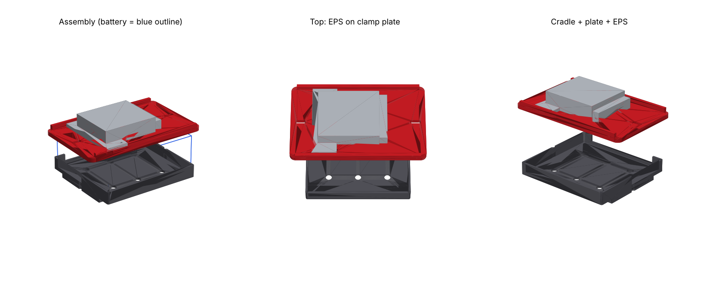

# PC680 on its side: OEM S2000 tray cradle + clamp plate with EPS mount

The Odyssey PC680 (184.5 × 79 × 169.5 mm, AGM) lies **on its long side** in the **OEM S2000 battery tray**. Odyssey rates the PC680 for mounting in any orientation. On its side the footprint is 184.5 × 169.5 mm, the battery is 79 mm tall, and the terminals face sideways.

The geometry is parametric and lives in [`battery_tray.py`](battery_tray.py). Run `pip install cadquery`, then `python3 battery_tray.py`, to regenerate `out/cradle.stl`, `out/clamp_plate.stl` and `out/assembly.step`.

| Part | Size (mm) | What it does |
|---|---|---|
| **Cradle** | 194.5 × 179.5 × 32 | Battery pocket with 1 mm clearance and 20 mm walls. A plug ring underneath drops into the OEM tray pocket so the cradle can't slide. The terminal-side wall has a cut-out. Slots let the J-bolts pass through, and there are drain holes. |
| **Clamp plate** | 244 × 150 × 16 | Sits on the battery's upturned side face, and the OEM J-bolts clamp it down. The **EPS module bolts on top**, using M5 bolts from below with heads recessed so they never touch the battery. |

## ⚠️ Measure and set before printing
These values in `battery_tray.py` are **placeholders**:
1. **`OEM_IN_X`, `OEM_IN_Y`:** the inside length and width of the OEM tray pocket.
2. **`ROD_POS`:** where the OEM J-bolt hooks are, as (x, y) from the tray centre.

**EPS module: done.** The hole pattern is measured at **115 × 30 mm**. The outline used for the fit check (`out/eps_reference.stl`) is estimated from a photo: about 133 mm across the flanges and about 135 mm from the flange edge to the connectors. To change the orientation, set `EPS_ROTATE` (0/90/180/270). `EPS_CONNECTORS` flips the connector direction, and `EPS_SHIFT` moves the module along it.

The J-bolt holes are 12 mm slots and the EPS holes are 4 mm slots, so small measurement errors are tolerated.

**Fit check:** on its side the battery is 169.5 mm across, so the cradle is about 180 mm across. That's likely wider than the OEM pocket, which is sized for the stock battery. The plug still locates inside the pocket, and the cradle floor overhangs the tray's edges. Confirm the overhang clears the surrounding trunk panels.

## Hardware
- **Hold-down:** OEM J-bolts, or M6 J-bolts or threaded rod, with nyloc nuts and large washers on top of the plate
- **EPS module:** 4 × M6 bolts (M5 also fits) from under the plate, with nyloc nuts and washers on the flanges
- **Pads:** 1–2 mm rubber or neoprene pad between the plate and the battery, and under the battery

## Printing
- **Material:** PA6-CF or PA12-CF, dried properly. Avoid PLA and PETG, which creep and soften under heat.
- **Settings:** 5–6 walls, 40%+ gyroid infill, 6 top/bottom layers
- **Cradle:** print floor-down.
- **Clamp plate:** print battery side down. The counterbores are on that side and print fine as small recesses.

## Install notes
- **Rod tension:** tighten the J-bolts until the battery can't move, then stop. Over-tightening bows the plate.
- **Terminals:** they face sideways, so make sure the **positive terminal can't touch body metal**. Cover both terminals, and fuse the main positive cable close to the battery.
- **Strength:** a printed cradle isn't crash-rated. Inspect it periodically for cracks or creep.
